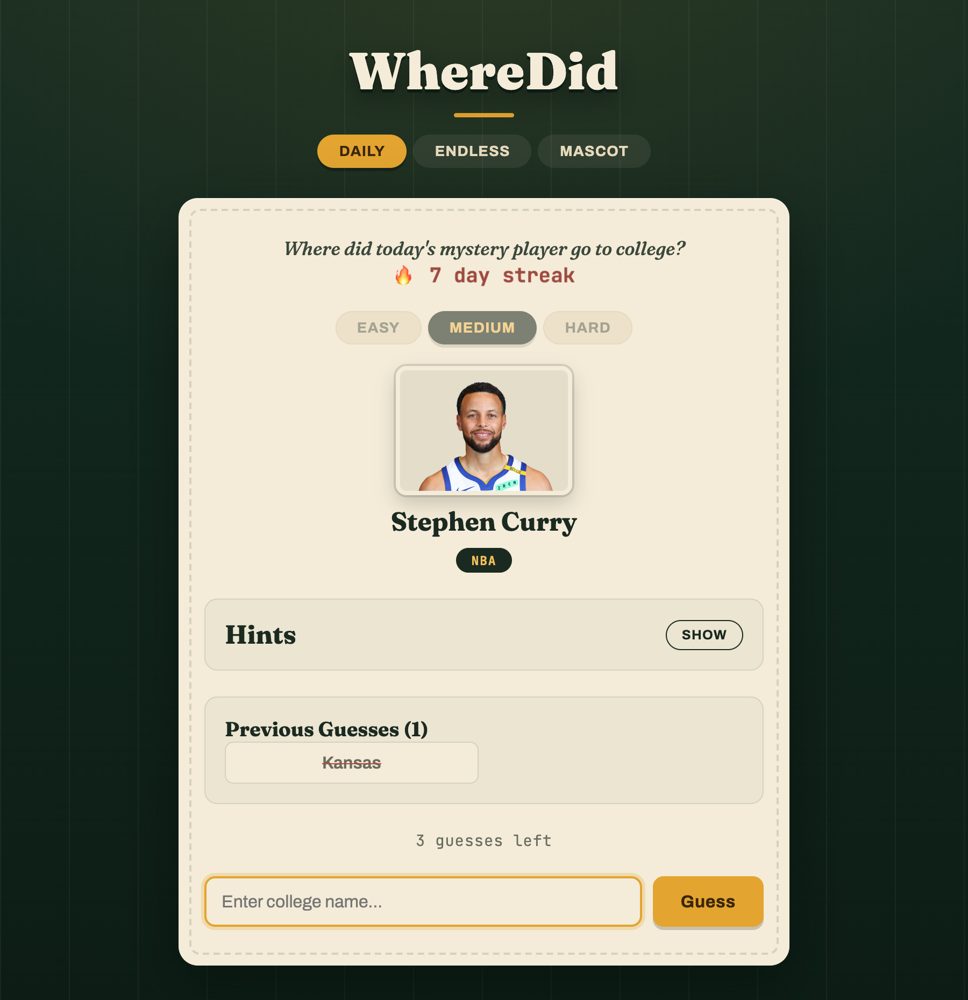
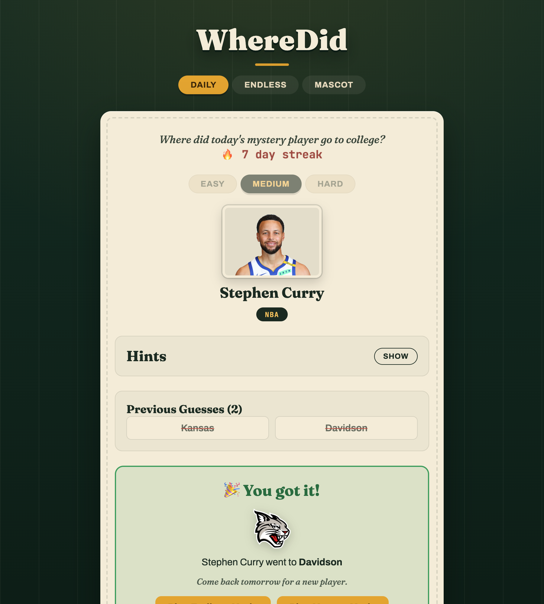
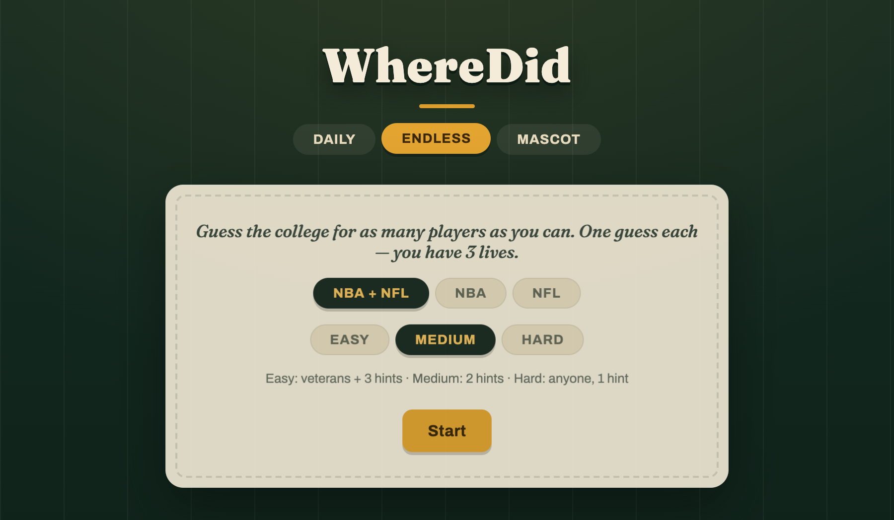
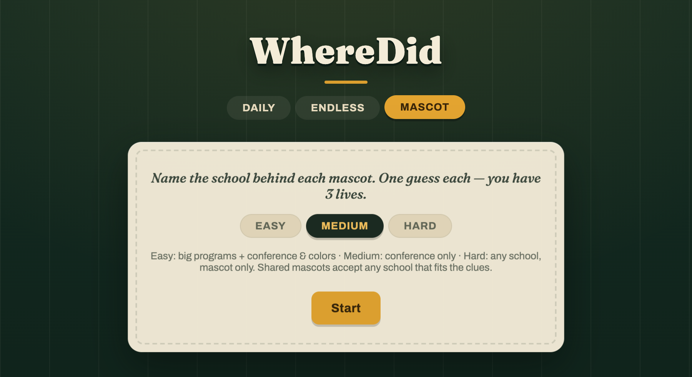

# WhereDid

A daily guessing game where players test their knowledge of NBA and NFL athletes.

## Overview

WhereDid is inspired by the classic game of asking friends "Where did they go to college?" and testing their knowledge of athletes' backgrounds. Our version turns that never-ending rabbit hole into a structured daily guessing game, challenging players to identify NBA and NFL athletes based on strategic hints about their careers and personal details.

Each day features a new mystery player that users must guess using strategic hints. The game features three difficulty levels to accommodate players of all knowledge levels.

## Screenshots

| Daily | Daily — solved |
| --- | --- |
|  |  |

| Endless | Mascot |
| --- | --- |
|  |  |

Earlier versions of the UI are kept in [images/archive](images/archive) for reference.

## Features

### Game Modes

- **Daily**: One mystery player per day, the same for everyone. Guess where they went to college before you run out of guesses. Wins build a daily streak.
- **Endless**: Rapid-fire. Guess the college for as many random players as you can, with one guess per player and 3 lives. Filter by NBA, NFL or both. Your best score is saved for each league and difficulty.
- **Mascot**: You're shown a college mascot and name the school. Same 3-lives format. Many mascots are shared (there are a lot of Bulldogs), so any school that fits every clue shown counts as correct.

### Difficulty

Every mode has Easy, Medium and Hard:

| Mode | Easy | Medium | Hard |
| --- | --- | --- | --- |
| Daily | 3 hints, 6 guesses | 2 hints, 4 guesses | 1 hint, 3 guesses |
| Endless | Veterans (8+ seasons), 3 hints | 4+ seasons, 2 hints | Anyone, 1 hint |
| Mascot | Big programs, conference + colors | 5+ pros, conference | Any school, mascot only |

Player hints are about the college: colors, then conference, then mascot.

### Planned Enhancements

- Leaderboards
- Social sharing of results
- Player filtering by team, position, era, etc.
- Additional sports integration

## Data Source

Player data comes from ESPN's public site API (`site.api.espn.com`). No API key is needed.

- Every NBA and NFL team roster is fetched (practice squads are skipped). Players without a college on record are excluded.
- Each college is enriched with its colors and conference from ESPN's college football / men's basketball team endpoints. NBA players get the basketball conference and NFL players the football conference.
- Players are upserted into MongoDB keyed by ESPN id (about 2,600 players from about 260 colleges).

The backend syncs automatically on startup when the database is empty or the data is more than 7 days old. This runs in the background and takes about 15 seconds. To sync manually:

```bash
cd backend
python ./scripts/sync_players.py        # both leagues
python ./scripts/sync_players.py NBA    # one league
```

Set `AUTO_SYNC=false` in `backend/.env` to turn off the startup sync. `scripts/seed_players.py` still inserts a small offline sample set. The ESPN sync removes those sample players once real data is loaded.

## Tech Stack

- **Frontend**: React 18 + TypeScript
- **Frontend Build Tool**: Vite
- **Frontend HTTP Client**: Axios
- **Backend**: FastAPI (Python)
- **Database**: MongoDB
- **Styling**: CSS3

## Getting Started

### Prerequisites

- Node.js 18+ (for frontend)
- Python 3.10+ (for backend)
- MongoDB 5.0+ (local or Atlas)

### Backend Setup

```bash
cd backend
python -m venv venv
source venv/bin/activate        # Windows: venv\Scripts\activate
pip install -r requirements.txt
cp .env.example .env            # then set MONGODB_URL if not using local MongoDB
```

### Frontend Setup

```bash
cd frontend
npm install
```

Optionally create `frontend/.env.local` with `VITE_API_URL=http://127.0.0.1:8000` to point the app at a different API.

### Running the Project

1. Start MongoDB (`mongod`, or use an Atlas connection string in `backend/.env`).
2. Start the backend from `backend/`:
   ```bash
   uvicorn main:app --reload --host 0.0.0.0 --port 8000
   ```
   The API is at `http://localhost:8000`, with docs at `http://localhost:8000/docs`. On first start it pulls players from ESPN in the background.
3. Start the frontend from `frontend/`:
   ```bash
   npm run dev
   ```
   The app is at `http://localhost:5173`.

### Build for Production

```bash
cd frontend && npm run build
cd backend && gunicorn -w 4 -k uvicorn.workers.UvicornWorker main:app
```

### API Overview

| Endpoint | Purpose |
| --- | --- |
| `GET /game/daily-challenge?difficulty=` | Today's player (stable for the whole day) |
| `GET /game/hints/{player_id}?difficulty=` | College hints for a player |
| `POST /game/guess` | Check a college guess |
| `GET /game/reveal/{player_id}` | Reveal the answer after a round ends |
| `GET /game/endless/next?league=&difficulty=&exclude=` | Random player for Endless mode |
| `GET /game/mascot/next?difficulty=&exclude=` | Random mascot for Mascot mode |
| `POST /game/mascot/guess` | Check a mascot guess |
| `GET /players/colleges?q=` | College name autocomplete |

## Game Rules

1. Each day a random established NBA or NFL player is chosen as the daily mystery player.
2. You get a limited number of guesses (based on difficulty) to name the college they attended.
3. Hints are about the college: colors, conference and mascot. Harder modes show fewer.
4. Common variants are accepted: "University of Michigan", "Michigan" and "MICH" all count.
5. When the round ends, the college and its logo are revealed. Progress and streaks are saved in your browser.

## Project Structure

```
WhereDid/
├── frontend/src/
│   ├── components/   # GameBoard, StreakGame (endless/mascot loop), CollegeInput, PlayerCard, OptionPicker
│   ├── pages/        # GamePage (daily), EndlessPage, MascotPage
│   ├── services/     # API client + localStorage helpers
│   └── types/
└── backend/
    ├── app/
    │   ├── routes/       # /game and /players endpoints
    │   ├── services/     # game logic; espn.py = ESPN ingestion
    │   ├── models/
    │   └── db/
    ├── scripts/          # sync_players.py (ESPN), seed_players.py (offline sample)
    └── main.py
```

## Documentation

Architecture, state machine and sequence diagrams (Mermaid) live in [docs/](docs/):

- [docs/architecture.md](docs/architecture.md)
- [docs/state-diagrams.md](docs/state-diagrams.md)
- [docs/sequence-diagrams.md](docs/sequence-diagrams.md)
- [docs/hosting.md](docs/hosting.md): hosting plan (Cloudflare Pages + Railway + MongoDB Atlas)

## Contributing

_To be updated_

## License

_To be updated_

## Authors

- ilanHascal1237
- maxosorio

---

_Last updated: November 3, 2026_
