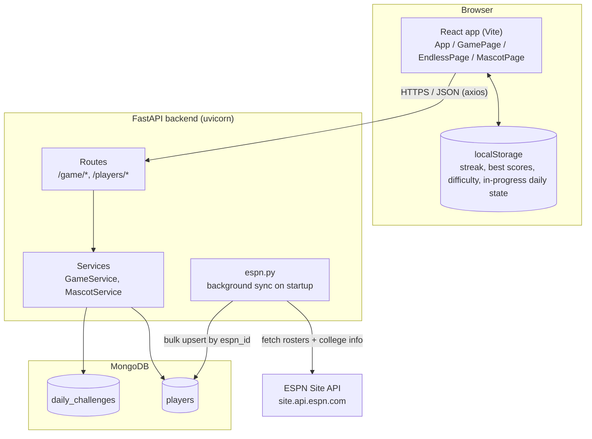
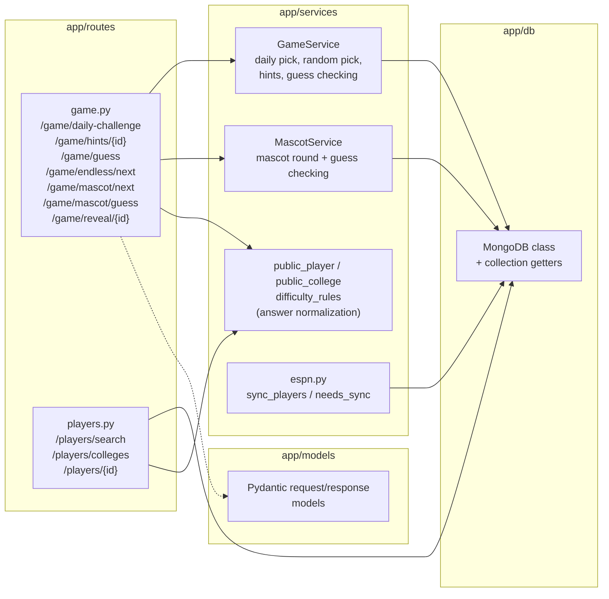

# Architecture

## System overview

React talks to FastAPI over REST; FastAPI is the only thing that talks to MongoDB. Player data itself originates from ESPN's public site API and is pulled in by a background sync job, not supplied by the user.

Notes:

- `game_sessions` is a defined-but-unused Mongo collection ([backend/app/db/\_\_init\_\_.py:42](../backend/app/db/__init__.py:42)) — no code path writes to it.
- The frontend never talks to ESPN or Mongo directly; all of that is hidden behind the FastAPI routes.
- `localStorage` is purely a client-side convenience (resume today's game, remember streak/best scores/settings) — it is not a source of truth for game data, which always comes from the backend.

## Backend module layering

