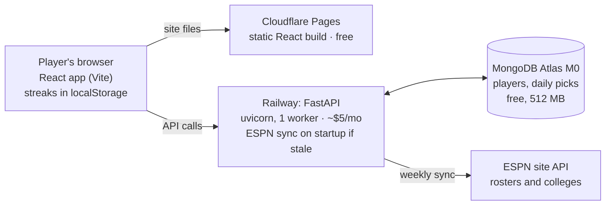

# Hosting plan

_Proposal as of 2026-11-04, sized for about 1,000 users. Not deployed yet._

## Recommendation

Host the frontend on **Cloudflare Pages**, the FastAPI backend as one always-on container on **Railway**, and the data on a free **MongoDB Atlas M0** cluster. Expected cost: about **$5/month**, plus an optional domain at about $10–12/year.

This keeps the code almost unchanged: the background ESPN sync, in-memory caches and FastAPI startup all work as they do locally. The only required code change is the daily-puzzle time zone (see [Changes needed](#changes-needed)). Prices are approximate, written from memory rather than looked up. Check each provider's pricing page before signing up.

## What 1K users needs

At 1,000 users the load is tiny: every option below handles it on its smallest plan. What actually matters is that the app responds right away and the daily puzzle changes at the right time.

| Factor | Estimate at 1K users | Why it matters |
| --- | --- | --- |
| Requests | ~20–40K per day, peaks of a few per second | One small instance is enough |
| Data | ~2,600 players, ~260 colleges, a few MB | Fits in Atlas's free 512 MB tier |
| Sync | ESPN pull of about 15 s, weekly | Needs a process that can run 15 s without being killed |
| Latency | Daily players often arrive in a burst in the morning | A sleeping server (30–50 s wake-up) would greet the first player each day with a hang |
| Daily rollover | Puzzle date comes from the server clock | Cloud servers run on UTC, so today the puzzle would flip at 7–8 pm US Eastern |

The request estimate assumes most users play the daily game plus a few Endless or Mascot rounds, about 20–40 API calls each.

## Options compared

The best option is a static frontend plus one small always-on container, which fixes the slow first load for about $5 a month. Full serverless is free but means rewriting how the sync runs, and a VPS is cheapest per dollar but makes you the sysadmin.

| Option | Approx. cost / month | Code changes | Cold starts | Main drawback |
| --- | --- | --- | --- | --- |
| **A. Cloudflare Pages + Railway + Atlas M0 (recommended)** | ~$5 | Time zone only | None | Small fixed cost |
| B. Cloudflare Pages + Fly.io + Atlas M0 | ~$2–5 | Time zone + Dockerfile, fly.toml | None | More setup; pay-as-you-go billing |
| C. All on Vercel (Python serverless) + Atlas M0 | $0 | Sync moved to a scheduled job; serverless entry point | ~1–3 s on idle | Hobby plan is non-commercial only; new DB connection on each cold start |
| D. Render free tier + Atlas M0 | $0 | Time zone only | 30–50 s after 15 min idle | First visitor after a quiet spell waits nearly a minute |
| E. One VPS (Hetzner, DigitalOcean) running app + MongoDB | ~$4–6 | Time zone + server setup | None | You handle OS updates, TLS, backups, and MongoDB yourself |

Cloudflare Pages is picked over Vercel or Netlify for the frontend because its free tier has unmetered bandwidth and allows commercial use. Vercel or Netlify would also work fine at 1K users.

## Recommended architecture

The browser gets the static site from Cloudflare Pages and calls the FastAPI backend on Railway directly. Only the backend talks to MongoDB Atlas and ESPN, exactly as it does locally today.

## Changes needed

One code fix is required, and the rest is configuration.

1. **Pin the daily puzzle to a time zone.** `GameService.get_daily_challenge` uses `datetime.now()` ([backend/app/services/\_\_init\_\_.py:104](../backend/app/services/__init__.py)), which is UTC on any cloud host. Change it to an explicit zone such as `datetime.now(ZoneInfo("America/New_York"))`, ideally read from a `GAME_TZ` env var. The frontend streak logic already trusts the server's date, so this one change is enough.
2. **Run one worker, not four.** The ESPN sync check runs when `main.py` is imported ([backend/main.py:31](../backend/main.py)). The README's `gunicorn -w 4` would start four syncs at once. Use `uvicorn main:app --host 0.0.0.0 --port $PORT`, which is plenty for 1K users.
3. **Set the CORS origin.** Set `FRONTEND_URL` to the deployed site (for example `https://wheredid.pages.dev`, or a custom domain). Only one non-localhost origin is read today, so if you serve from both the `pages.dev` URL and a custom domain, extend the `origins` list in `backend/main.py`.
4. **Point the frontend at the API.** Set `VITE_API_URL` to the Railway URL in Cloudflare Pages' build settings. It's baked in at build time, so changing it means rebuilding the site.
5. **Pin the Python version** (for example 3.11, via a `.python-version` file in `backend/`) so Railway's build matches what you test locally.
6. **Use the existing health check.** Point Railway's health check at `GET /health`, which already exists.

## Deployment checklist

About an afternoon of work, in this order:

- [ ] **Atlas:** create a free M0 cluster in the same cloud region as Railway (for example AWS us-east-1).
- [ ] **Atlas:** add a database user with a strong password, and allow network access from `0.0.0.0/0` (Railway has no fixed outbound IP on the Hobby plan).
- [ ] **Code:** make the time-zone fix and pin the Python version, then merge to `main`.
- [ ] **Railway:** create a project from the GitHub repo, with root directory `backend` and the uvicorn start command above.
- [ ] **Railway:** set `MONGODB_URL`, `DATABASE_NAME=wheredid`, `FRONTEND_URL`, `AUTO_SYNC=true` and `GAME_TZ`.
- [ ] **Railway:** deploy, watch the logs for the ESPN sync finishing (~15 s), then check `/health` and `/game/daily-challenge`.
- [ ] **Cloudflare Pages:** connect the repo, with root `frontend`, build `npm run build`, output `dist`, and `VITE_API_URL` set to the Railway URL.
- [ ] **Smoke test:** play Daily, Endless and Mascot on desktop and phone, and confirm no CORS errors in the browser console.
- [ ] **Optional:** buy a domain, point it at Pages (site) and Railway (`api.` subdomain), and update `FRONTEND_URL` and `VITE_API_URL`.
- [ ] **Optional:** add a free uptime monitor (for example UptimeRobot) on `/health`.

## Risks and open questions

The biggest risk is ESPN, not the hosting: the whole dataset depends on an unofficial API.

- **ESPN API is unofficial.** It can change shape or start blocking cloud IPs without notice. The app already keeps the last good data in Mongo, so a failed sync leaves the game playable on stale rosters. Watch the sync logs after each weekly run.
- **Hotlinked logos.** College logos load straight from ESPN's servers. If ESPN blocks hotlinking, logos break but the game still works.
- **Atlas M0 is shared.** There is no backup or SLA on the free tier. Export the `players` and `daily_challenges` collections now and then (`mongodump`), mainly to keep past daily picks.
- **Atlas pauses idle clusters.** Free clusters can be paused after a long stretch with no connections. Steady daily traffic avoids that.
- **Open question: which time zone?** US Eastern midnight is assumed. Pick whatever matches most of your players.
- **Open question: commercial use?** If you ever add ads or payments, check each provider's terms. The recommended stack allows it; Vercel Hobby does not.

## When to scale up

Nothing needs to change until roughly 20–50x the 1K-user target. Approximate triggers:

| Signal | Move | Approx. added cost / month |
| --- | --- | --- |
| Atlas storage near 400 MB, or slow queries | Atlas Flex tier | ~$8–30 |
| API p95 latency over ~300 ms, or CPU steadily over 70% | Raise Railway's instance size, then add a second replica (move the sync to a scheduled job first so replicas don't all sync) | ~$5–20 |
| Need for backups or a stated uptime | Atlas M10 dedicated cluster | ~$57 |
