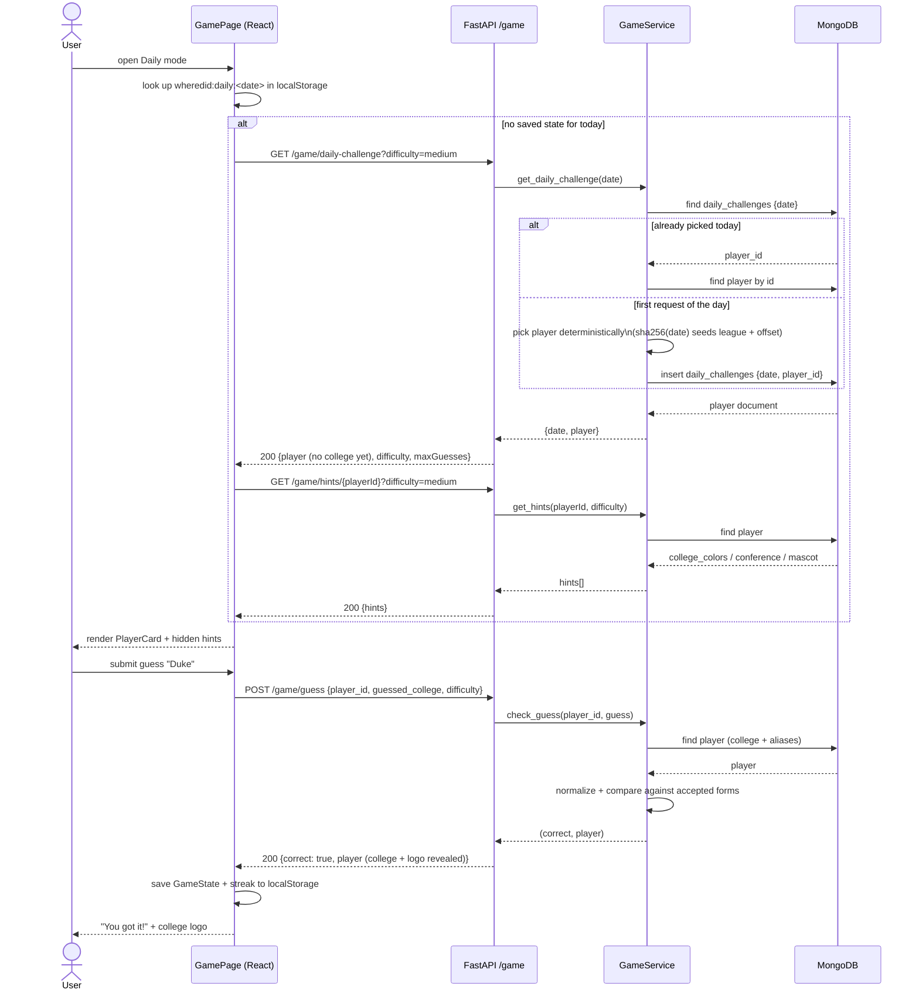

# Sequence Diagrams

## Daily challenge: load + correct guess



## Endless / Mascot: one round of the streak loop

`StreakGame` is mode-agnostic; `EndlessPage` wires it to `/game/endless/next` + `/game/guess`, `MascotPage` wires it to `/game/mascot/next` + `/game/mascot/guess`.

```mermaid
sequenceDiagram
    actor U as User
    participant SG as StreakGame (React)
    participant Page as EndlessPage / MascotPage
    participant API as FastAPI /game
    participant Svc as GameService / MascotService
    participant DB as MongoDB

    U->>SG: click "Start"
    SG->>Page: fetchRound(seenIds = [])
    Page->>API: GET /game/endless/next?league&difficulty&exclude
    API->>Svc: get_random_player(league, difficulty, exclude)
    Svc->>DB: $match (college set, experience, position) + $sample(1)
    DB-->>Svc: random player
    Svc-->>API: {player, hints}
    API-->>Page: 200 round data
    Page-->>SG: {id, prompt, hints}
    SG-->>U: render round (phase = playing)

    U->>SG: submit guess (or Skip)
    SG->>Page: checkGuess(roundId, guess)
    Page->>API: POST /game/guess (or /game/mascot/guess)
    API->>Svc: check_guess(...)
    Svc->>DB: find player / grouped college, compare normalized forms
    DB-->>Svc: match result
    Svc-->>API: (correct, revealed entity)
    API-->>Page: {correct, college/player (revealed)}
    Page-->>SG: {correct, answer, logo}
    SG->>SG: update score; lives-- if wrong/skipped
    alt new best score
        SG->>SG: save best to localStorage
    end
    SG-->>U: show feedback panel (phase = feedback)

    U->>SG: click "Next"
    alt lives remaining
        SG->>Page: fetchRound(seenIds + roundId)
        Note over SG,Page: repeats the fetch-round steps above
    else lives exhausted
        SG-->>U: Game Over screen (phase = over)
    end
```

## ESPN roster sync (startup background job)

```mermaid
sequenceDiagram
    participant Main as main.py (startup)
    participant DB as MongoDB (players)
    participant Thread as background thread
    participant ESPN as ESPN Site API

    Main->>DB: connect_db()
    Main->>DB: needs_sync()? (newest players.updated_at)
    DB-->>Main: stale / missing, or fresh

    alt stale or missing (> 7 days or empty)
        Main->>Thread: start sync_players() [daemon thread]
        Note over Main: API serves requests immediately,\nnot blocked on sync

        Thread->>ESPN: GET teams (NBA, NFL)
        ESPN-->>Thread: team ids

        par per team (16-worker thread pool)
            Thread->>ESPN: GET /teams/{id}/roster
            ESPN-->>Thread: athletes[]
        end

        Thread->>Thread: keep athletes with a college on record

        par per distinct college
            Thread->>ESPN: GET college-football / college-basketball team
            ESPN-->>Thread: colors, conference, mascot, logo
        end

        Thread->>Thread: build player documents
        Thread->>DB: bulk upsert by espn_id
        Thread->>DB: create indexes (espn_id unique, league+experience)
        Thread->>DB: delete_many(source != "espn")
        Note over DB: drops the hand-seeded sample players
    else fresh data already present
        Main->>Main: skip sync
    end
```


