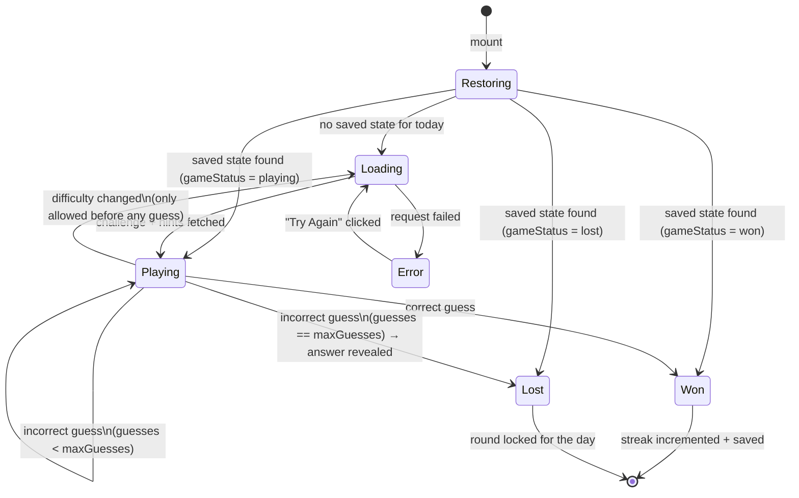
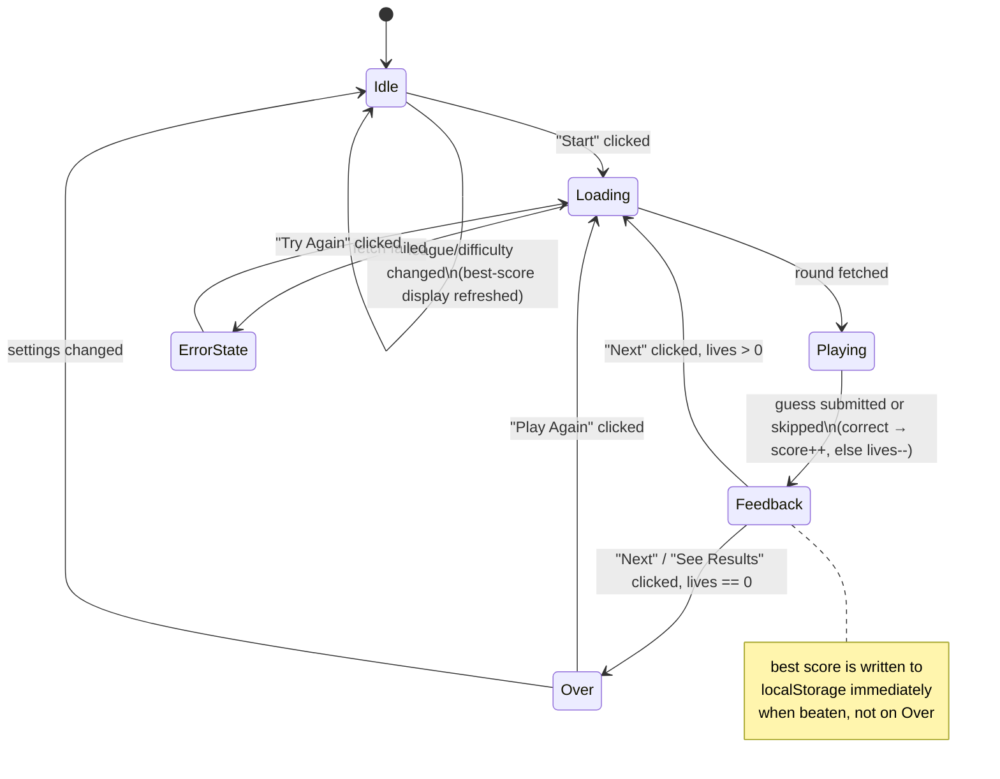

# State Transition Diagrams

## Daily mode ([GamePage.tsx](../frontend/src/pages/GamePage.tsx))

One round per day. Progress is persisted to `localStorage` under `wheredid:daily:<date>`, so a reload restores whichever state the round was left in.

## Endless & Mascot modes ([StreakGame.tsx](../frontend/src/components/StreakGame.tsx))

Shared rapid-fire loop: one guess per round, 3 lives, used by both `EndlessPage` and `MascotPage` with different `fetchRound`/`checkGuess` implementations.

